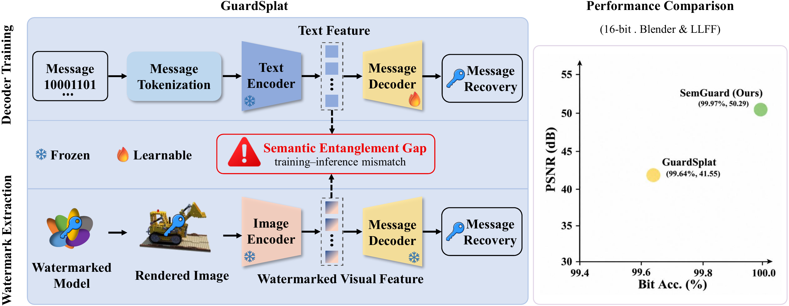
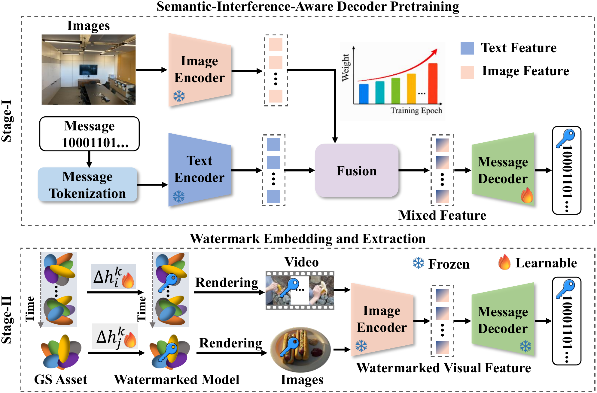
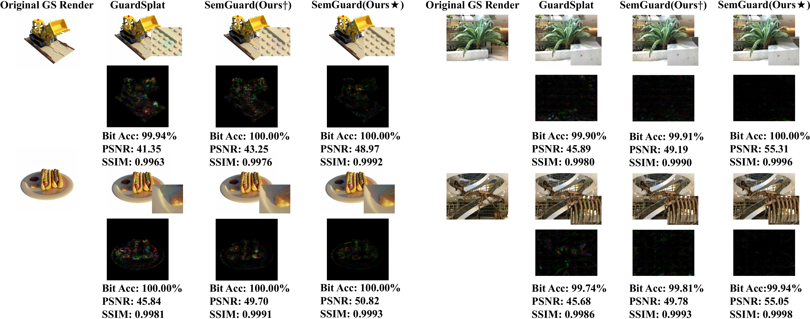

# SemGuard: Semantics-Decoupled Watermarking for Gaussian Splatting

**Yingying Shi, Zhong Zhou, Bin Zhou**  
Beihang University, Zhongguancun Laboratory, and Peace-Bay Academy of Virtual Reality

Official implementation of SemGuard. The manuscript and supplementary PDF will be released later.

**TL;DR:** SemGuard pretrains a message decoder with progressively stronger scene-dependent visual semantic interference, then freezes the decoder and embeds watermarks by optimizing spherical-harmonic (SH) offsets in static and dynamic Gaussian assets.

<p align="center"></p>

## Framework

<p align="center"></p>

SemGuard first combines message-related CLIP text features with visual features from unwatermarked scene images to train a message decoder under progressive semantic interference. The decoder and CLIP encoders are then frozen while asset-specific SH offsets are optimized for watermark embedding. For dynamic Gaussian assets, temporal image features are aggregated during decoding.

## 1) Environment and dependencies

```bash
git clone https://github.com/shisyy/SemGuard.git
cd SemGuard
```

Environment and dependency commands are provided in the author's [requirements.txt](requirements.txt). This file is preserved in its original form and contains installation commands. Follow the commands there together with the original backbone installation instructions:

- Static Gaussian assets: [3D Gaussian Splatting](https://github.com/graphdeco-inria/gaussian-splatting).
- Dynamic Gaussian assets: [4DGaussians](https://github.com/hustvl/4DGaussians).

The two backbone repositories are maintained by their original authors and are not bundled here. The SemGuard source files, configuration and stage scripts are uploaded unchanged from the author's supplied source directory.

## 2) Data and clean Gaussian assets

SemGuard uses four benchmark datasets:

| Type | Dataset | Gaussian backbone |
| --- | --- | --- |
| Static | [NeRF Synthetic / Blender](https://www.matthewtancik.com/nerf) | 3D Gaussian Splatting |
| Static | [LLFF](https://bmild.github.io/llff/) | 3D Gaussian Splatting |
| Dynamic | [D-NeRF](https://github.com/albertpumarola/D-NeRF) | 4DGaussians |
| Dynamic | [HyperNeRF](https://github.com/google/hypernerf) | 4DGaussians |

The author's processed Gaussian assets are available separately on the [data download page](https://github.com/shisyy/SemGuard/releases/tag/rendered-assets-v2). Extract the downloaded archives to obtain `output/<dataset>/<scene>/`. These assets include clean Gaussian models, deformation parameters for dynamic models, associated metadata and available rendered views. Original image/camera datasets are obtained from their respective authors.

See [data preparation and provenance](DATA_PREPARATION.md) for scene lists, checksums and extraction instructions. The supplied assets were generated with author-modified backbone code/settings, so unmodified upstream code is not guaranteed to generate identical assets.

## 3) Stage I: train the watermark decoder

Both [setup_run_3d.sh](setup_run_3d.sh) and [setup_run_4d.sh](setup_run_4d.sh) contain a **Stage 1: Train the watermark decoder** section. It uses [make_decoder_divid.py](make_decoder_divid.py), with CLIP/message utilities and semantic image sources defined in [ms_utils_divid.py](ms_utils_divid.py).

The scripts define the decoder experiment name as:

```bash
EXP_NAME=${DECODER_BASE_NAME}_msg${msg_len}_${num_epochs}_${type_fusion_weight}
```

The supplied decoder-training command is:

```bash
python make_decoder_divid.py \
    --mode train \
    --msg_len $msg_len \
    --save \
    --num_epochs $num_epochs \
    --sdir decoders/nerf_synthetic/${EXP_NAME} \
    --type_fusion_weight $type_fusion_weight \
    --type_fusion_weight_max 0.9 \
    --type_fusion_weight_min 0.0
```

The script comments specify 400 decoder epochs for 4/8/16-bit messages and 800 for 32/48-bit messages, with `continuous` as the example interference schedule. Set the variables for the intended experiment using the provided scripts. Semantic image sources are selected through `used_datasets` and the dataset paths in `ms_utils_divid.py`; these remain as supplied by the author.

## 4) Stage II: watermark embedding and evaluation

Use the complete commands in the matching author-provided stage script:

| Gaussian asset | Stage script | Watermark entry point |
| --- | --- | --- |
| Static 3DGS | [setup_run_3d.sh](setup_run_3d.sh) | [run_3Ddivid.py](run_3Ddivid.py) |
| Dynamic 4DGS | [setup_run_4d.sh](setup_run_4d.sh) | [run_4Ddivid.py](run_4Ddivid.py) |

Each script contains a **Stage 2: Train and evaluate** section followed by an evaluation section. Training uses `--mode train`; evaluation uses `--mode eval`, the saved decoder and the watermark results from the matching experiment. The evaluation commands also show checkpoint selection with `--resume_num` and visual output with `--save_map`.

Configure the variables used by these existing commands:

| Variable | Meaning in the supplied scripts |
| --- | --- |
| `root` | Original dataset directory |
| `out_root` | Clean Gaussian model directory |
| `exp_root` | Watermark experiment output directory |
| `item` | Scene name |
| `mdir` | `$out_root/$item` |
| `sdir` | `$exp_root/${EXP_NAME}/$item` |
| `msg_len` | Watermark message length |
| `num_epochs2` | Watermark optimization epochs |
| `resume_num` | Watermark checkpoint selected for evaluation |

The decoder path in both supplied scripts is `decoders/nerf_synthetic/${EXP_NAME}`. Follow the actual script values for the experiment rather than an additional launch wrapper.

Set the scene paths as shown in the scripts, replacing the placeholders with your own directories and scene name:

```bash
root="<your_nerf_dir>"
out_root="<your_render_dir>"
exp_root="<your_Watermark_output_dir>"
item="<nerf_item>"
mdir=$out_root/$item
sdir=$exp_root/${EXP_NAME}/$item
```

### Static 3DGS: embedding

From the Stage 2 section of `setup_run_3d.sh` (the supplied example uses NeRF Synthetic):

```bash
python run_3Ddivid.py \
    --decoder_path decoders/nerf_synthetic/${EXP_NAME} \
    -s "$root/$item" \
    -m "$mdir" \
    -w \
    --mode train \
    --msg_len "$msg_len" \
    --sdir "$sdir" \
    --batch_size 16 \
    --dtype blender \
    --num_epochs2 "$num_epochs2"
```

### Static 3DGS: evaluation and visualization

Set `resume_num` to the checkpoint you want to evaluate, as specified in the script:

```bash
resume_num="<your_resume_num>"
python run_3Ddivid.py \
    --decoder_path decoders/nerf_synthetic/${EXP_NAME} \
    -s "$root/$item" \
    -m "$mdir" \
    -w \
    --mode eval \
    --msg_len "$msg_len" \
    --sdir "$sdir" \
    --batch_size 16 \
    --dtype blender \
    --num_epochs2 100 \
    --test_cams 10 \
    --resume_num "$resume_num" \
    --save_map
```

### Dynamic 4DGS: embedding

The corresponding command from the Stage 2 section of `setup_run_4d.sh` is reproduced with its supplied arguments:

```bash
python run_4Ddivid.py \
    --decoder_path decoders/nerf_synthetic/${EXP_NAME} \
    -s "$root/$item" \
    -m "$mdir" \
    -w \
    --mode train \
    --msg_len "$msg_len" \
    --sdir "$sdir" \
    --batch_size 16 \
    --dtype blender \
    --num_epochs2 "$num_epochs2"
```

### Dynamic 4DGS: evaluation and visualization

From the evaluation section of `setup_run_4d.sh`:

```bash
resume_num="<your_resume_num>"
python run_4Ddivid.py \
    --decoder_path decoders/nerf_synthetic/${EXP_NAME} \
    -s "$root/$item" \
    -m "$mdir" \
    -w \
    --mode eval \
    --msg_len "$msg_len" \
    --sdir "$sdir" \
    --batch_size 16 \
    --dtype blender \
    --num_epochs2 100 \
    --test_cams 10 \
    --resume_num "$resume_num" \
    --save_map
```

## 5) Stage III: visual distortions for 3DGS

The **Stage 3: Add visual distortions to the 3DGS model** section of [setup_run_3d.sh](setup_run_3d.sh) provides single-distortion and combined-distortion settings and the associated command. Distortions are implemented in [attack_utils.py](attack_utils.py).

The supplied single-distortion list contains Gaussian noise, rotation, resize, Gaussian blur, crop, brightness, JPEG compression and VAE compression. The combined example contains crop, brightness and JPEG compression. Use the parameters and command in that script for the intended experiment.

The distortion settings in `setup_run_3d.sh` are:

```bash
# Single distortions
attacks=(
  GaussianNoise
  Rotation
  Resize
  GaussianBlur
  Crop
  Brightness
  JPEGCompress
  VAEBmshj2018
)

# Combined distortions
combined_attacks=(
  Crop
  Brightness
  JPEGCompress
)
```

The Stage 3 command is transcribed below, retaining the entry-point filename and arguments written in the author's script. Set `decoder_path`, `attack`, `batch_size`, `learning_rate`, `lambda_msg` and `eval_interval` for the intended distortion experiment:

```bash
python run_3Ddivid_.py \
    --decoder_path "$decoder_path" \
    -s "$root/$item" \
    -m "$mdir" \
    -w \
    --mode train \
    --msg_len "$msg_len" \
    --sdir "$sdir" \
    --batch_size "$batch_size" \
    --dtype blender \
    --atypes "$attack" \
    --learning_rate "$learning_rate" \
    --lambda_msg "$lambda_msg" \
    --num_epochs2 100 \
    --eval_interval "$eval_interval"
```

## Qualitative comparison

<p align="center"></p>

Paper figure comparing original renders, GuardSplat and SemGuard. The star denotes the static semantic image pool; the dagger denotes the mixed static/dynamic pool.

## Citation

```bibtex
@article{shi2026semguard,
  title={SemGuard: Semantics-Decoupled Watermarking for Gaussian Splatting},
  author={Shi, Yingying and Zhou, Zhong and Zhou, Bin},
  year={2026}
}
```

## Acknowledgements

This work builds on [GuardSplat](https://github.com/NarcissusEx/GuardSplat), [3D Gaussian Splatting](https://github.com/graphdeco-inria/gaussian-splatting), [4DGaussians](https://github.com/hustvl/4DGaussians), [CLIP](https://github.com/openai/CLIP) and [Diff-JPEG](https://github.com/necla-ml/Diff-JPEG). We thank their authors for releasing their code. Dataset ownership and applicable terms remain with the original authors.

Contact: Yingying Shi, `yyshi@buaa.edu.cn`.
