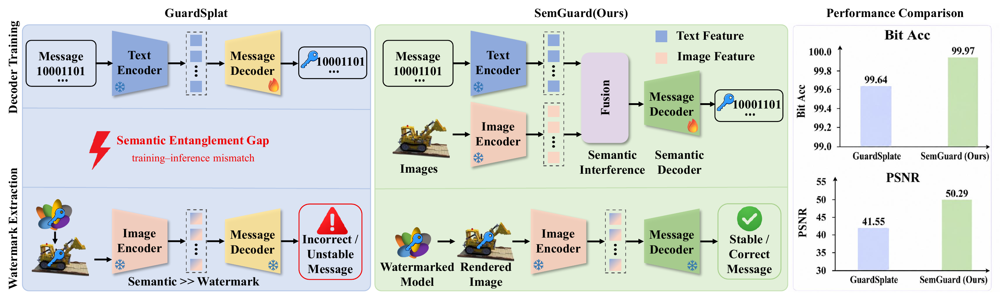
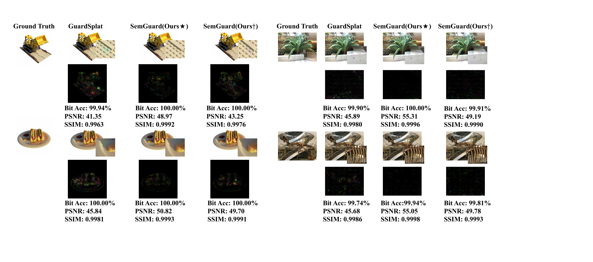

# SemGuard: Semantics-Decoupled Watermarking for Gaussian Splatting

Official implementation of **SemGuard: Semantics-Decoupled Watermarking for Gaussian Splatting**.

**Yingying Shi, Zhong Zhou, Bin Zhou**  
Beihang University, Zhongguancun Laboratory, and Peace-Bay Academy of Virtual Reality

[[Paper](paper/SemGuard.pdf)] [[Supplementary](paper/SemGuard_supp.pdf)]

> **TL;DR:** SemGuard closes the semantic-entanglement gap in CLIP-guided Gaussian watermarking. It pre-trains a reusable message decoder with progressively stronger visual-semantic interference, then freezes the decoder and embeds messages by optimizing compact spherical-harmonic offsets in static or dynamic Gaussian assets.

<p align="center"></p>

## Overview

Existing CLIP-guided methods train a decoder on watermark-centric text features but deploy it on rendered image features dominated by scene semantics. SemGuard explicitly simulates this mismatch during decoder pre-training:

1. A binary message is tokenized and encoded by the frozen CLIP text encoder.
2. Images from 3D and 4D datasets are encoded by the frozen CLIP image encoder.
3. Text and image features are fused with a progressive interference weight.
4. A lightweight decoder learns to recover the message from the mixed feature.
5. During watermark embedding, the decoder and CLIP encoder are frozen; only Gaussian SH offsets are optimized.

<p align="center"></p>

## Installation

The released scripts use Python 3.12, PyTorch 2.5.1, CUDA 12.1, and an NVIDIA GPU.

```bash
git clone https://github.com/shisyy/SemGuard.git
cd SemGuard

conda create -n semguard python=3.12 -y
conda activate semguard
bash setup.sh
```

The repository includes the modified 4DGaussians source used by the experiments. `setup.sh` builds its CUDA rasterizer and KNN extensions, then installs the remaining Python dependencies.

## Data and pretrained Gaussian assets

SemGuard uses four datasets to construct semantic interference during decoder learning:

- [D-NeRF](https://www.albertpumarola.com/research/D-NeRF/index.html) (4D)
- [HyperNeRF](https://hypernerf.github.io/) (4D)
- [LLFF](https://bmild.github.io/llff/) (3D)
- [NeRF Synthetic](https://www.matthewtancik.com/nerf) (3D)

Arrange the data as follows:

```text
SemGuard/
├── 4DGaussians/data/
│   ├── dnerf/<scene>/train/*.png
│   └── hypernerf/virg/<scene>/images/*
├── data/
│   ├── nerf_llff_data/<scene>/images_8/*.png
│   └── nerf_synthetic/<scene>/train/*.png
└── pretrained/
    ├── dnerf/<scene>/
    └── hypernerf/<scene>/
```

The dataset roots can be overridden without editing source files:

```bash
export SEMGUARD_DATA_ROOT=/path/to/data
export DNERF_DATA_ROOT=/path/to/dnerf
export HYPERNERF_DATA_ROOT=/path/to/hypernerf/virg
export LLFF_DATA_ROOT=/path/to/nerf_llff_data
export NERF_SYNTHETIC_DATA_ROOT=/path/to/nerf_synthetic
```

The active semantic sources are controlled by `used_datasets` in `ms_utils_divid.py`. The paper configuration uses all four datasets:

```python
used_datasets = [
    "dnerf",
    "hypernerf",
    "nerf_llff_data",
    "nerf_synthetic",
]
```

Train the clean dynamic Gaussian assets with the included `4DGaussians` implementation before watermark embedding. Put the resulting model directories under `pretrained/`, or override `DNERF_MODEL_ROOT` and `HYPERNERF_MODEL_ROOT`.

## Stage I: semantic-robust decoder learning

The final paper configuration trains 16-, 32-, and 48-bit decoders with continuous semantic interference from 0.0 to 0.9. A single decoder can be trained with:

```bash
python make_decoder_divid.py \
  --mode train \
  --msg_len 16 \
  --num_epochs 800 \
  --batch_size 64 \
  --save \
  --sdir decoders/dnerf/divid_msg16_800_continuous \
  --type_fusion_weight continuous \
  --type_fusion_weight_min 0.0 \
  --type_fusion_weight_max 0.9
```

## Stage II: watermark embedding and evaluation

The main experiment entry point is:

```bash
bash run_allstage_divid2.sh
```

By default, the script evaluates:

- D-NeRF: `bouncingballs`, `hellwarrior`, `hook`, `jumpingjacks`, `lego`, `mutant`, `standup`, and `trex`.
- HyperNeRF: `3dprinter`, `banana`, `broom2`, and `chicken`.
- Message lengths: 16, 32, and 48 bits.
- Stage-II optimization: 100 epochs, 100 sampled viewpoints, and 8 temporal frames.

Paths and device selection can be changed through environment variables:

```bash
CUDA_VISIBLE_DEVICES=0 \
DNERF_DATA_ROOT=/path/to/dnerf \
DNERF_MODEL_ROOT=/path/to/pretrained/dnerf \
HYPERNERF_DATA_ROOT=/path/to/hypernerf/virg \
HYPERNERF_MODEL_ROOT=/path/to/pretrained/hypernerf \
OUTPUT_ROOT=/path/to/results \
bash run_allstage_divid2.sh
```

For a single scene, use `run_divid.py` directly. Example:

```bash
python run_divid.py \
  --decoder_path decoders/dnerf/divid_msg16_800_continuous \
  --source_path 4DGaussians/data/dnerf/lego \
  --model_path pretrained/dnerf/lego \
  --configs 4DGaussians/arguments/dnerf/lego.py \
  --dataset_type blender \
  --mode train \
  --msg_len 16 \
  --sdir outputs/dnerf/divid_msg16_800_continuous/8frame/lego \
  --batch_size 8 \
  --train_num_views_per_time_real 100 \
  --test_num_views_per_time 100 \
  --train_num_frame_real 8 \
  --test_num_frame 8 \
  --num_epochs2 100
```

Datasets, pretrained Gaussian models, decoder checkpoints, and experiment outputs are intentionally excluded from Git. See `.gitignore` for the complete list.

## Qualitative results

<p align="center"></p>

## Repository structure

```text
.
├── 4DGaussians/                 # modified dynamic Gaussian renderer and loaders
├── assets/                      # README figures
├── paper/                       # manuscript and supplementary material
├── make_decoder_divid.py        # Stage-I decoder training
├── ms_utils_divid.py            # decoder, data sources, and shared utilities
├── run_divid.py                 # Stage-II 4D watermark embedding/evaluation
├── dnerf_utils.py               # dynamic-scene loading utilities
├── attack_utils.py              # differentiable and evaluation distortions
└── run_allstage_divid2.sh       # final multi-dataset experiment pipeline
```

Additional `*_gard`, `*_uni`, and `*_view` files contain baseline and ablation variants used during the study.

## Citation

If you find this work useful, please cite:

```bibtex
@article{shi2026semguard,
  title   = {SemGuard: Semantics-Decoupled Watermarking for Gaussian Splatting},
  author  = {Shi, Yingying and Zhou, Zhong and Zhou, Bin},
  year    = {2026}
}
```

## Acknowledgements

This code builds on [GuardSplat](https://github.com/NarcissusEx/GuardSplat), [4DGaussians](https://github.com/hustvl/4DGaussians), [3D Gaussian Splatting](https://github.com/graphdeco-inria/gaussian-splatting), [CLIP](https://github.com/openai/CLIP), and [Diff-JPEG](https://github.com/necla-ml/Diff-JPEG). We thank the authors for releasing their code.

The top-level license applies to original SemGuard code. Vendored third-party components retain their original license files and source headers.

## Contact

For questions, please contact Yingying Shi at `yyshi@buaa.edu.cn`.
